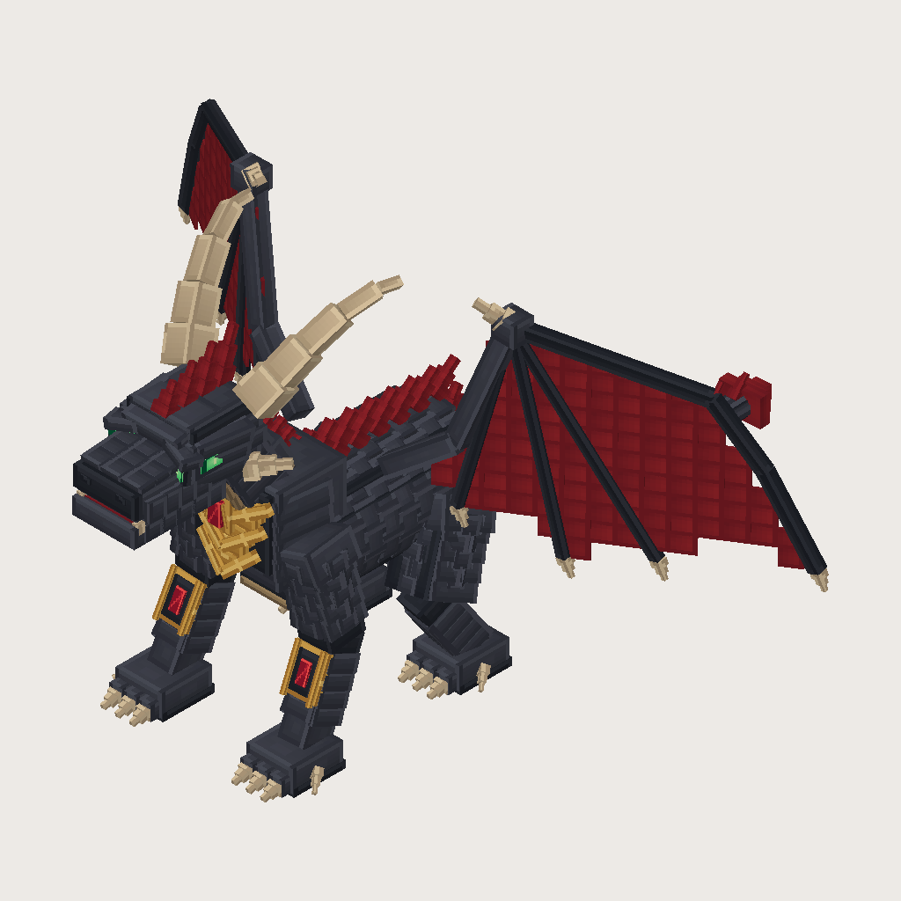
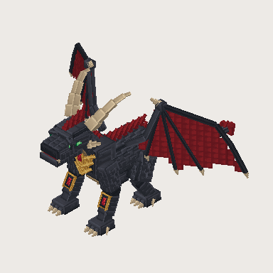
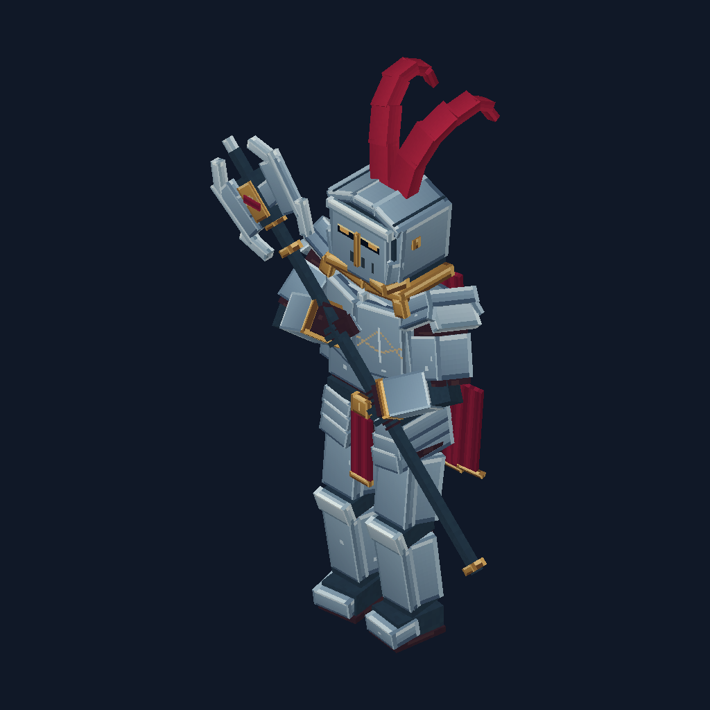
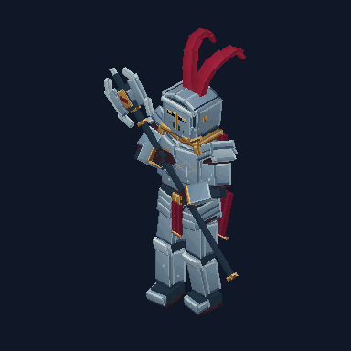

# Formixel

Formixel 1.5 is a CLI-first, local model compiler and bounded modeling workflow. A planner returns BBScript/FXL, a declarative design document or a selected-part patch. Formixel validates the data, paints explicit surface plans, checks numeric rig constraints and produces editable Blockbench models with local review artifacts. Codex CLI and Claude Code are the primary planners. OpenAI and Anthropic APIs are optional, explicitly selected providers.

The local compiler works offline with no provider account. It supports cuboids, nested groups, rotations, materials, static RGBA textures, face UVs, symmetry/repetition, numeric bone animation, atomic patches, inspection and PNG/GIF previews. A paired Blockbench workspace delegates deliberate generation/refinement requests to an authenticated loopback CLI bridge. The optional MCP adapter stays limited to three local FXL tools. Arbitrary meshes, particles, emissive/PBR rendering, Molang and direct Minecraft game-pack export are not implemented.

Version 1.5 adds role-labeled reference packs, per-part atlas plans, target-based limb motion, sampled ground/grip/bend checks, caller-selected anatomy requirements, scoped texture/animation repair, portable model context and checksummed review ZIPs. References and local diagnostics support human review; they do not identify anatomy automatically or certify artistic fidelity. See the [implementation status](docs/IMPLEMENTATION_STATUS.md) for release evidence and remaining live host/account gates.

New in 1.4: the [Obsidian Crimson Dragon](docs/OBSIDIAN_DRAGON.md), a quadrupedal fixture with a mapped pixel atlas, articulated wings/jaw/tail, four attacks and two looping clips. The reproducible local generator writes six views, motion previews and attack contact sheets. Run `node scripts/generate-dragon.mjs dist/showcase/dragon`, then `node scripts/package-dragon.mjs dist/showcase/dragon` to make its separate asset pack.





For explicit texture and motion authoring, open the [Crimson Paladin](docs/CRIMSON_PALADIN.md). It has individually packed face regions, a 512x512 atlas, a solved limb rig, a poleaxe grip and three baked clips. Its reproducible fixture demonstrates the core atlas/rig APIs. Open-ended provider models still need deliberate silhouette, texture and animation review.





New in 1.3: bounded pixel-atlas packing, a numeric two-bone solver, hierarchy marker checks and local GIF motion rendering with a fixed camera. See [authoring tools](docs/AUTHORING.md) for contracts, frame budgets and practical review.

New in 1.2: explicit PNG references for native Codex planning, pixel-sensitive cache fingerprints, corrected native face UV orientation/rotation in PNG previews, quieter metal/cloth recipes and reference-led proportion guidance. The older [Elderwood Warden](docs/ELDERWOOD_WARDEN.md) remains available as a forest example.

New in 1.1: reusable FXL components, six local pixel surface recipes, reported provider usage, opt-in validated source cache, technical quality diagnostics and six PNG camera views. The [Ironroot Knight fixture](examples/ironroot_knight.fxl) compiles 85 cuboids from a 4212-byte source. See [efficiency and review](docs/EFFICIENCY.md) for the reproducible comparison and its limits.

## Run the release

Install Node.js 22 or newer, extract the release ZIP, then:

```sh
node formixel.mjs --help
node formixel.mjs build examples/forest_golem.fxl -o golem.bbmodel
node formixel.mjs inspect golem.bbmodel
node formixel.mjs quality golem.bbmodel
node formixel.mjs render examples/ironroot_knight.fxl --view front -o knight-front.png
node formixel.mjs render examples/forest_golem.fxl -o golem.png --animation idle --time 0.5
node formixel.mjs render examples/crimson_paladin.bbmodel --animation walk --size 384 -o paladin-walk.gif
node formixel.mjs import golem.bbmodel -o golem.bbir.json
node formixel.mjs validate golem.bbir.json
node formixel.mjs doctor
```

The ZIP bundles runtime dependencies, the plugin, examples, schemas, docs and licenses. No npm install is needed to run it. Verify its SHA-256 file and internal checksums before distribution. Open the compiled project as a Generic Model in Blockbench 5.x. For game use, export it through the appropriate Blockbench format/plugin.

## Develop from source

```sh
npm ci --ignore-scripts
npm run check
npm run formixel -- build examples/golem.fxl -o golem.bbmodel
npm run formixel -- patch examples/golem.fxl --patch examples/golem.patch.json -o patched.bbir.json
npm run release
```

Source commands run after building. Tests also build and extract the release into an independent temporary directory and exercise the real CLI/MCP there. The CI matrix is configured for Windows/Linux with Node 22/24. Release output is `dist/release/formixel-1.5.0.zip`. A configured matrix is not evidence that the current revision has passed it; see [validation](docs/VALIDATION.md). `npm run benchmark` checks equivalent compact/expanded FXL and reports source bytes, not token estimates.

## Author, review and refine

Use a design document following the [declarative authoring contract](docs/DESIGN.md), or request one from an explicitly selected provider:

```sh
node formixel.mjs author design.json --anatomy prop -o authored.zip
node formixel.mjs craft "A small plated stone guardian with a readable idle clip" --anatomy biped --provider codex --cache .formixel/workflows -o guardian.zip
node formixel.mjs review guardian/model.bbmodel -o guardian-review.json
node formixel.mjs refine guardian/model.bbmodel --select node:body/head --instruction "Widen the brow while keeping the neck attachment" --provider codex -o guardian-refined.zip
node formixel.mjs bridge
```

Extract `guardian.zip` to `guardian/` before the review/refine examples and replace the selection with an actual ID from `inspect`. `craft` requires a complete surface plan and explicit rig constraints, then runs local technical and production-policy checks. `author` executes an existing bounded design locally. `review` reports checks on existing geometry; a failing review writes its report and exits 1. `refine` allows only the selected nodes/resources and their permitted surface/track changes. Each generation/refinement makes one intentional request on a cache miss, with no automatic repair loop.

Choose `--anatomy prop`, `biped` or `quadruped` deliberately. `--floor`, `--forward x,0,z`, `--airborne clip-id` and `--weapon-hands 1|2` express caller requirements. Semantic roles identify the exact bones, soles and grip markers to measure; they can come from the design or explicit `--roles roles.json` on review/refine. These declarations and finite pose samples do not prove anatomical or artistic correctness. Default `prop` makes no articulated-character claim.

The ZIP includes editable native/BBIR models, six views, bounded motion previews, `review.json`, `preview.html`, checksums and a design document when available. `motion.json` lists included and omitted clips. It also preserves the brief, roles and constraints in `model.context.json`; native outputs embed digest-bound `formixel_context`. Review/refine reuse valid context and reject stale metadata after model changes. For the matching BBIR and sidecar, use:

```sh
node formixel.mjs review guardian/model.bbir.json --context guardian/model.context.json -o guardian-bbir-review.json
```

Keep the context beside its exact model. An editor may strip custom metadata or change IDs; reload an explicitly checked rig declaration when needed. A sidecar for one canonical model is not interchangeable with an editor-rewritten model. The [maintenance guide](docs/MAINTENANCE.md) describes the binding and trusted remapping API.

In Blockbench, load `formixel.js`, open Tools → Formixel → Modeling workspace, then pair with the bridge's printed loopback address and session token. Generate, inspect **Review result**, then explicitly **Apply result** to open a new project. See [Blockbench workflow and host limits](docs/BLOCKBENCH.md).

## Plan a model

Authenticate the separately installed native CLI yourself, then:

```sh
node formixel.mjs generate "A forest knight with a strong silhouette" --provider codex --cache .formixel/cache -o generated.fxl
node formixel.mjs generate "Silver knight, red cape, swept crest and poleaxe" --provider codex --reference knight.png --cache .formixel/cache -o referenced.fxl
node formixel.mjs generate "A small textured stone golem" --provider claude-code -o generated.fxl
node formixel.mjs build generated.fxl -o generated.bbmodel
```

Optional API: set OPENAI_API_KEY or ANTHROPIC_API_KEY in your environment and select `--provider openai --model YOUR_MODEL` or `--provider anthropic --model YOUR_MODEL`. Formixel makes one request and validates the response locally before saving. It never falls back to paid APIs, retries automatically, grants broad shell permissions or evaluates generated text. Windows providers must be native executables; command-shell wrappers are deliberately unsupported. `doctor` checks installation/auth status without generating or spending tokens.

Provider transports have subprocess and mocked HTTP tests. Check installation/account compatibility with doctor and a provider smoke test; see [validation](docs/VALIDATION.md).

Generation prints actual provider-reported usage when available. Matching cache hits make zero generation requests and still run local validation. Omit `--cache` for new variations. Texture recipes and geometry expansion run locally; no automatic critique or repair requests are made. Valid syntax and clean technical diagnostics do not guarantee visual quality.

Legacy `generate/run --reference` accepts one explicitly selected static RGB/RGBA8 PNG. The 1.5 `craft/refine/review --references references.json` path accepts one to eight ordered role/path entries. Paths resolve relative to the manifest. Each normalized PNG is limited to 1 MB, 262144 pixels and 1024 pixels per side; packs also have aggregate budgets. Image planning currently requires Codex. Other providers fail locally instead of dropping references. Crop plain-background orthographic references for silhouette overlays; those overlays measure aligned foreground occupancy, not aesthetic similarity. See [reference authoring](docs/REFERENCE_AUTHORING.md) and [provider contracts](docs/PROVIDERS.md).

```json
[
  { "role": "front", "path": "front.png" },
  { "role": "right", "path": "right.png" },
  { "role": "texture", "path": "palette.png" }
]
```

Use `--force` to replace an existing output. CLI failures exit 1 and preserve existing output. Inputs are bounded; unsupported import features produce errors.

See [language](docs/FXL.md), [assets/animation](docs/ASSETS.md), [design](docs/DESIGN.md), [scoped repair](docs/REPAIR.md), [evaluation](docs/EVALUATION.md), [architecture](docs/ARCHITECTURE.md), [security](docs/SECURITY.md), [providers](docs/PROVIDERS.md), [Blockbench](docs/BLOCKBENCH.md), [MCP](docs/MCP.md), [release](docs/RELEASE.md) and [maintenance guide](docs/MAINTENANCE.md).

### Independent particles and emission

After building the source checkout, run `node scripts/effects-demo.mjs ../formixel-effects-demo.zip` to create an editable Copperback example with independent flame particles, eye emission, PNG/GIF previews and limited Bedrock integration files. Open the archive's README before using target assets.

`formixel render model.bbir.json --particles particles.json --emission emission.json --animation alert -o preview.gif` previews exact digest-bound sidecars locally. `formixel effects model.bbir.json --particles particles.json` validates a document; `--target bedrock --namespace formixel --entity sentinel -o assets.zip` explicitly exports only the supported subset. See [particles](docs/PARTICLES.md), [target limitations](docs/PARTICLE_EXPORT.md) and [emission masks](docs/EMISSION.md). Generic native files do not automatically carry game particles or emission behavior.
